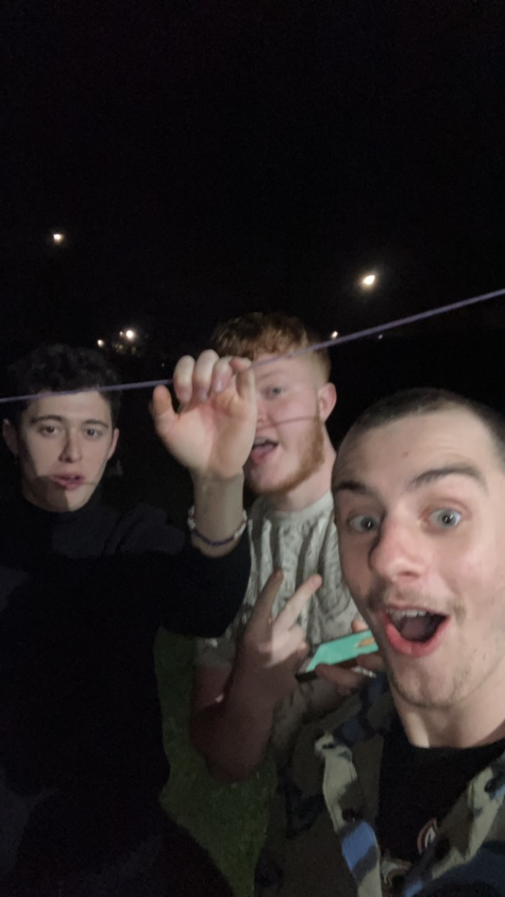

# Task 3: Configuring the ODrive
## Context
The ODrive is what will be handling the logic and controlling the motors. Think of it as an Arduino, but designed to handle much higher voltages and more demanding applications.

It can be programmed using Python, allowing us to communicate with the controller and configure how the motors behave.
Code example for import
```python
import odrive

odrv0 = odrive.find_any()
```
This imports the ODrive library and attempts to find a connected ODrive controller.
It's quite an important part of the project, so it's worth taking some time to familiarise yourself with it and do a bit of research before moving forward.
## Task One: Understanding the ODrive
Watch this video to get a better understanding of what the ODrive is and what it does:
**[THE ODRIVE!!!](https://www.youtube.com/watch?v=Ym3srZ0MRIA)**
## Task Two: Installing Python
Unless you already have a Python interpreter installed, you'll need to get one set up.
There are several different environments you can use to write and run Python. Here are a few options:

* [PyCharm](https://www.jetbrains.com/pycharm/)
* [Visual Studio Code](https://code.visualstudio.com/)
* [Wing IDE](https://wingware.com/)
* [Spyder](https://www.spyder-ide.org/)
* [JupyterLab](https://jupyter.org/)

I'd provide more detailed instructions on how I did it, but the process seems to vary depending on your operating system and setup. Choose whichever environment you're most comfortable with.

## Task Three: Installing ODrive

Unfortunately, installing and configuring these sorts of things can be quite difficult. It's taken me hours before, days even!

Anyway, here's the guide I used. I found it quite useful when getting everything set up:
Follow the instructions to install the ODrive Python tools on your computer.
**[ODrive Installation Guide – odrivetool](https://docs.odriverobotics.com/v/latest/interfaces/odrivetool.html#install-odrivetool)**
## Don't worry if it doesn't work
Installing these things can be hit or miss, long or short, oil or vinegar.
Your all winners today
