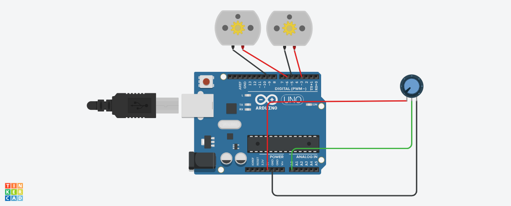

# Build guide
## Context
To progress to the next stages of this motor controller we'll gain deeper insights by building a demonstratable prototype that uses the linear vectorisation and electric steering.
This prototype will be using an arduino as the "brains" calculating the motor output from the linear vectorisation, 5volt motors to act as the 48 volt motors on the car and the potionometer as the electric steering.
## Electric car step 1. Electric rc
# What you'll need
A laptop, everything else should be in the box
#### Step 1 wire / configure prototype
Okay so you want to take your arduino uno and configure it as shown:

#### Step 2 Install Arduino IDE
In order to program the linear steering you'll need to code the arduino.
You can do that by downloading the IDE
https://docs.arduino.cc/software/ide/
#### Step 3 Programming
Once downloaded and installed the IDE
create file and name it: controller.ino

To open the file it'll ask you to create a folder, press yes. Then you should be in the IDE there you can copy and paste the code from [here](https://github.com/frederickengland/Formula_society/blob/main/code/arduino_code/arduino_code.ino)
when you are ready press the tick and the arrow and it should be uploaded to the arduino.
#### Step 4 testing
Test components, motors should turn more on one side based on where the dial is turned.
Basically the dial should affect the motors
After that stage 1 is complete and you have made a proof of concept.
#### Congratulations
You've made a basic version of the electric car

Next we'll work on adding the throttle.
