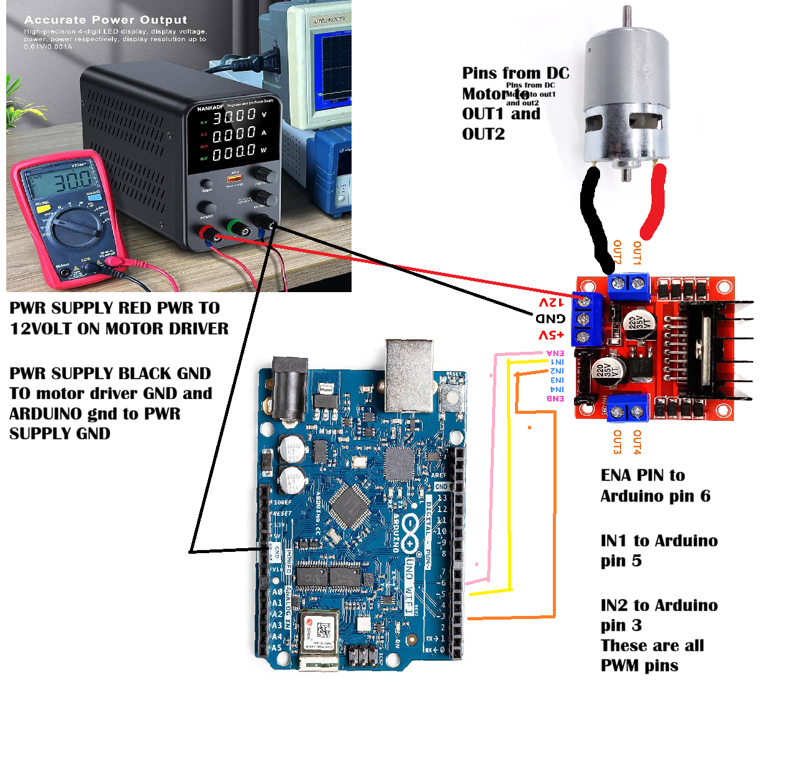

# TASK 2: Using Motor Drivers

## Context
Last week, we learnt how to control 3.2V motors using potentiometers. This week, we're moving on to motor drivers, which allow us to control motors that require higher voltages while still being programmable.

This brings us to the L298N motor driver. This module allows us to control motors using a separate power supply, making it useful for powering motors that require more voltage than the Arduino can provide.

The power supply connects to the motor driver, which then connects to the motors. The Arduino connects to the motor driver to control the motors.

# Concerns
Upload the code to the Arduino before connecting the power supply. Then, disconnect the USB-B cable from your laptop and connect it to a suitable USB power source instead. This helps protect your laptop if anything goes wrong during testing.

## Step 1 - Programming
Since I've found it useful to program everything before configuring the hardware, I thought I'd switch things up and start with the programming this time.

You can find the code [here](https://github.com/frederickengland/Formula_society/blob/main/code/hbridge/hbridge.ino).

Once you've finished, upload the code to the Arduino using the arrow button in the top-right corner of the Arduino IDE.

## Step 2 - Configuration
Keep the potentiometer setup from last week's task, using the same wiring to control the motor.

Make sure the potentiometer is wired correctly before moving on to testing.

## Step 3 - Testing
Once the code has been uploaded, the Arduino will run it automatically when powered on.

Connect the Arduino to your USB power source and set the bench power supply to **12V with a maximum current limit of 3A**, provided these settings are suitable for your motor driver and motors.

When everything is ready, enable the power supply output and start turning the potentiometer to control the motor.

## Step 4 - Congratulations!
Great job! You've now configured and tested a motor driver.

Next, we'll begin working on the next and final step: **[THE ODRIVE!!!](https://www.youtube.com/watch?v=Ym3srZ0MRIA)**
